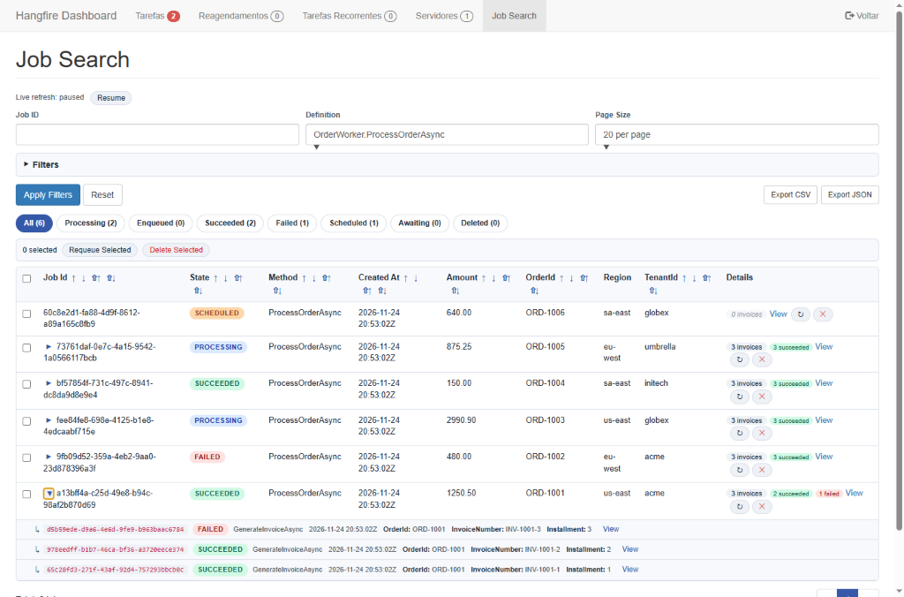
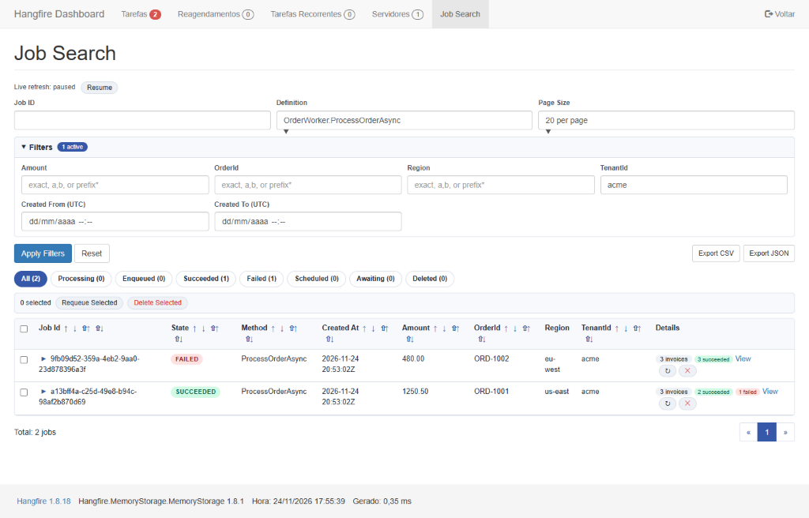

# fksegundo.Hangfire.Dashboard.JobSearch

Hangfire Dashboard extension for indexing job arguments and showing them as searchable, filterable, sortable columns inside the Hangfire Dashboard.

The project is intended for applications where the default Hangfire job lists are not enough to find a job by business-specific values stored in job arguments, such as tenant IDs, document IDs, customer IDs, order IDs, or any other field your application passes to background jobs.

## Screenshots

### Dashboard Overview & Parent/Child Fan-Out Joins



### Advanced Filters, Date Range & Live State Tabs



## Features

- **Business Parameter Search**: Index any job parameter via strongly-typed Fluent API (`options.AddJob<TWorker>(...)`), declarative `[JobSearchField]` attributes, JSON paths (including nested properties and array indexing like `$.Items[0].Sku`), or custom value extractors.
- **Advanced Filtering**: Exact match, multi-value (`acme,globex`), prefix wildcards (`ORD-10*`), and UTC date range (`CreatedFrom` / `CreatedTo`).
- **Modular Storage Providers**:
  - **Redis (`RedisJobSearchStorage`)**: Server-side set intersections (`ZINTERSTORE`), single-round-trip Lua state counts, optional Redis Cluster hash tags, atomic Lua state transitions, and automatic TTL cleanup.
  - **SQL Server (`SqlServerJobSearchStorage`)**: Parameterized `Microsoft.Data.SqlClient` provider with automatic schema/index preparation and `GROUP BY` state counts.
  - **PostgreSQL (`PostgreSqlJobSearchStorage`)**: Parameterized `Npgsql` provider with `text_pattern_ops` prefix indexes and `= ANY(...)` bulk child lookups.
  - **In-Memory (`InMemoryJobSearchStorage`)**: Built-in adapter with optional `maxEntries` and `expiry` limits for local testing and prototyping.
- **Parent/Child Fan-Out Joins (`JobSearchJoin`)**: Expand parent jobs into interactive sub-rows displaying associated child workers and per-state progress badges.
- **Interactive Hangfire Dashboard**: Clickable state count tabs (including `All` and `Awaiting`), partial `fetch()` auto-refresh (preserving expanded rows and filter focus), multi-column sorting, `PageSize` selector, CSV/JSON export, and quick individual/bulk Requeue & Delete actions (respecting `IsReadOnly`).
- **Backfill Utility (`JobSearchBackfillService`)**: Index pre-existing jobs from Hangfire's `JobStorage` when adopting JobSearch on an existing application.

## Packages

| Package | Description |
|---|---|
| `fksegundo.Hangfire.Dashboard.JobSearch` | v1.x meta-package (includes **Core + Redis** with full backward compatibility) |
| `fksegundo.Hangfire.Dashboard.JobSearch.Core` | Lightweight core library with zero database/Redis dependencies |
| `fksegundo.Hangfire.Dashboard.JobSearch.Redis` | Redis storage provider (`StackExchange.Redis`) |
| `fksegundo.Hangfire.Dashboard.JobSearch.SqlServer` | SQL Server storage provider (`Microsoft.Data.SqlClient`) |
| `fksegundo.Hangfire.Dashboard.JobSearch.PostgreSql` | PostgreSQL storage provider (`Npgsql`) |

## Repository Layout

```text
src/Hangfire.Dashboard.JobSearch/               v1.x backward-compatible meta-package (Core + Redis)
src/Hangfire.Dashboard.JobSearch.Core/          Core library (netstandard2.0, zero DB dependencies)
src/Hangfire.Dashboard.JobSearch.Redis/         Redis storage provider
src/Hangfire.Dashboard.JobSearch.SqlServer/     SQL Server storage provider
src/Hangfire.Dashboard.JobSearch.PostgreSql/    PostgreSQL storage provider
tests/Hangfire.Dashboard.JobSearch.Tests/       Unit & Integration tests (xUnit + Testcontainers)
examples/Hangfire.Dashboard.JobSearch.Example/  Runnable sample app (.NET 10)
docs/                                           Detailed technical specifications, guides & screenshots
```

## Quick Start

### 1. Register Services

```csharp
using Hangfire;
using Hangfire.Dashboard.JobSearch;
using StackExchange.Redis;

var builder = WebApplication.CreateBuilder(args);

builder.Services.AddHangfire(config => config.UseMemoryStorage());
builder.Services.AddHangfireServer();

builder.Services.AddHangfireJobSearch(options =>
{
    // Choose a storage provider (or omit for InMemoryJobSearchStorage):
    // options.UseRedisStorage(redis, keyPrefix: "hangfire:jobsearch", expiry: TimeSpan.FromDays(7), useClusterHashTag: true);
    // options.UseSqlServerStorage(connectionString);
    // options.UsePostgreSqlStorage(connectionString);

    // Fluent strongly-typed job definition
    options.AddJob<OrderWorker>(w => w.ProcessOrderAsync(default!), job => job
        .Field<OrderJobArgs>(a => a.TenantId, sortable: true)
        .Field<OrderJobArgs>(a => a.OrderId, sortable: true)
        .Field<OrderJobArgs>(a => a.Amount, sortable: true));

    // Or auto-discover fields from [JobSearchField] attributes on the argument DTO
    options.AddJob<InvoiceWorker>(w => w.GenerateInvoiceAsync(default!), job => job
        .DiscoverFieldsFromAttributes());

    // Optional: Configure parent-child correlation join
    options.AddJoin(new JobSearchJoin
    {
        KeyField = "OrderId",
        ParentJobType = typeof(OrderWorker),
        ParentMethodName = nameof(OrderWorker.ProcessOrderAsync),
        ChildJobType = typeof(InvoiceWorker),
        ChildMethodName = nameof(InvoiceWorker.GenerateInvoiceAsync),
        ChildLabel = "invoices"
    });
});
```

### 2. Configure Dashboard

```csharp
app.UseHangfireDashboard("/hangfire");
GlobalConfiguration.Configuration.UseJobSearch(app.Services);
```

### 3. Open the Dashboard

Navigate to:
```text
/hangfire/job-search
```

## Documentation

Comprehensive guides and architectural details are available in the [`/docs`](docs/) directory:

- [Architecture & Internals](docs/architecture.md): Lifecycle hooks, filters, metadata extraction pipeline.
- [Redis Storage Provider](docs/storage-redis.md): Server-side indexing data structures, Lua transitions, TTL cleanup.
- [Parent/Child Job Joins](docs/parent-child-joins.md): Fan-out correlation configuration and resolver.
- [Configuration & UI Guide](docs/configuration-guide.md): Field options, sorting, filters, and custom storages.

## Running the Example Application

Start the sample app (seeds realistic `Succeeded`, `Processing`, `Failed`, `Scheduled`, and parent/child jobs automatically):

```bash
dotnet run --project examples/Hangfire.Dashboard.JobSearch.Example/Hangfire.Dashboard.JobSearch.Example.csproj --urls http://127.0.0.1:5099
```

Open `http://127.0.0.1:5099/hangfire/job-search?state=all` in your browser, or enqueue additional orders via:

```bash
curl -X POST http://127.0.0.1:5099/enqueue-order
```

## Running Tests

Execute test suite across supported runtimes:

```bash
dotnet test Hangfire.Dashboard.JobSearch.slnx
```

*(Integration tests automatically leverage Testcontainers for Redis).*

## Contributing

Contributions, bug reports, and pull requests are welcome! Please check out [CONTRIBUTING.md](CONTRIBUTING.md) and our [CODE_OF_CONDUCT.md](CODE_OF_CONDUCT.md).

## Security

Please report vulnerabilities responsibly according to our [SECURITY.md](SECURITY.md).

## License

This repository is licensed under the [Apache-2.0](LICENSE) License.

## Third-Party Licenses

This project depends on third-party packages. Those dependencies keep their own license terms:
- [Hangfire](https://www.hangfire.io/licenses.html)
- [StackExchange.Redis](https://github.com/StackExchange/StackExchange.Redis/blob/main/LICENSE)
- [Microsoft.Data.SqlClient](https://github.com/dotnet/SqlClient/blob/main/LICENSE)
- [Npgsql](https://github.com/npgsql/npgsql/blob/main/LICENSE)
